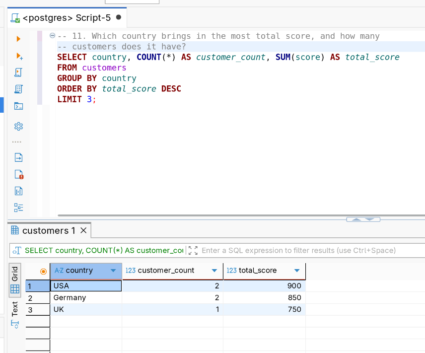
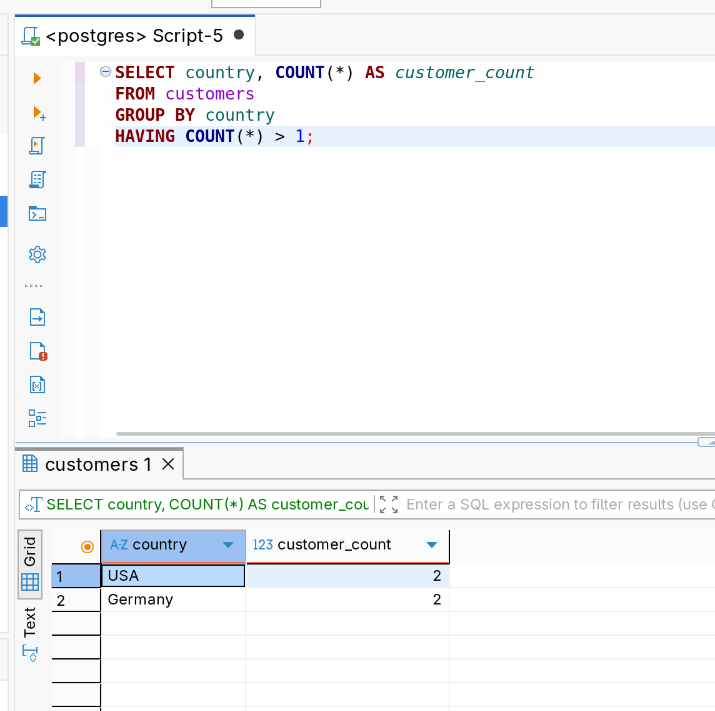
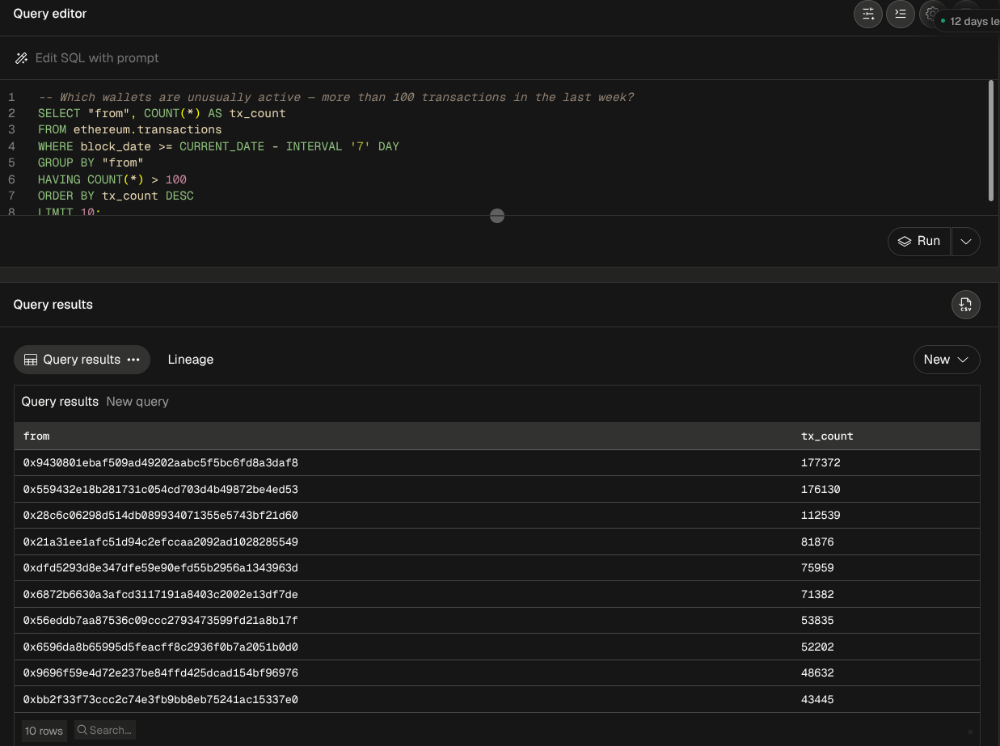

# Week 1: SQL Fundamentals

## Concepts covered

`SELECT`, `DISTINCT`, `FROM`, `WHERE`, `GROUP BY`, `HAVING`, `ORDER BY`,
`LIMIT`, plus DDL (`CREATE`, `ALTER`, `DROP`) and DML
(`INSERT`, `UPDATE`, `DELETE`) basics.

## Dataset

`MyDatabase` — a small, deliberately simple dataset used to keep the focus
on the fundamentals rather than schema complexity:

- `customers` (id, first_name, country, score)
- `orders` (order_id, customer_id, order_date, sales)

Setup script: [`dataset/init-mydatabase.sql`](./dataset/init-mydatabase.sql)

## Files

- [`queries.sql`](./queries.sql) — traditional SQL, simple → complex
- [`onchain-queries.sql`](./onchain-queries.sql) — same concepts applied to
  Ethereum data on Dune
- [`ddl-dml-basics.sql`](./ddl-dml-basics.sql) — CREATE/ALTER/DROP,
  INSERT/UPDATE/DELETE, practiced on a throwaway table
- [`notes.md`](./notes.md) — what I learned and what tripped me up
- `screenshots/postgres/`, `screenshots/dune/` — result screenshots

## Highlights

**Which country brings in the most total score, and how many customers
does it have?** (`GROUP BY` + `SUM` + `ORDER BY` + `LIMIT` — the most
complex query this week)

```sql
SELECT country, COUNT(*) AS customer_count, SUM(score) AS total_score
FROM customers
GROUP BY country
ORDER BY total_score DESC
LIMIT 3;
```



**Which countries have more than one customer?** (`HAVING` — filtering
after aggregation, not before)

```sql
SELECT country, COUNT(*) AS customer_count
FROM customers
GROUP BY country
HAVING COUNT(*) > 1
ORDER BY customer_count DESC;
```



**Onchain: how has daily Ethereum transaction volume trended over the
last 30 days?** (same `GROUP BY` logic, applied on Dune)

```sql
SELECT block_date, COUNT(*) AS tx_count
FROM ethereum.transactions
WHERE block_date >= CURRENT_DATE - INTERVAL '30' DAY
GROUP BY block_date
ORDER BY block_date;
```



## Query execution order

A useful thing to internalize early: the order you *write* a query isn't
the order it *runs* in.

- **Written:** `SELECT → FROM → WHERE → GROUP BY → HAVING → ORDER BY`
- **Executed:** `FROM → WHERE → GROUP BY → HAVING → SELECT → ORDER BY`

That's why a `SELECT` alias works in `ORDER BY` but not in `WHERE` —
`WHERE` runs before `SELECT` has created anything.