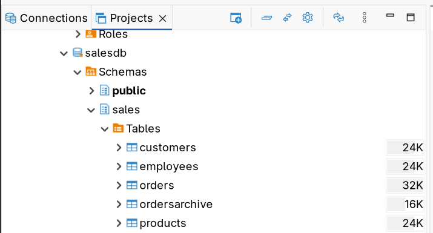
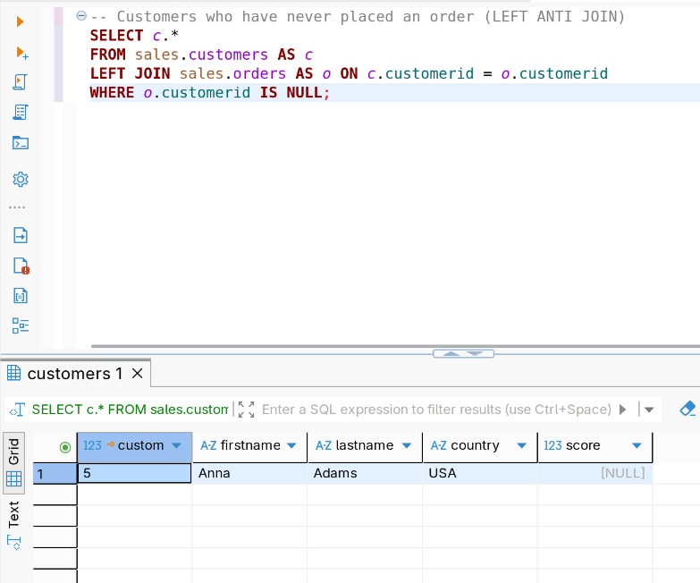
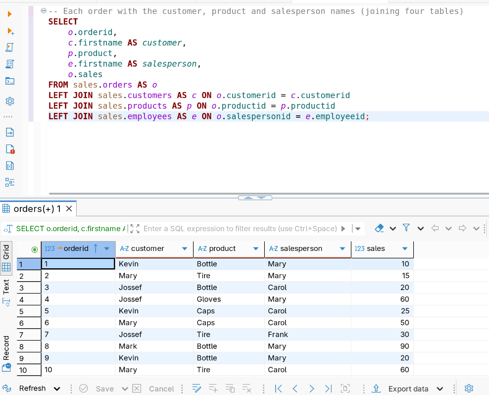
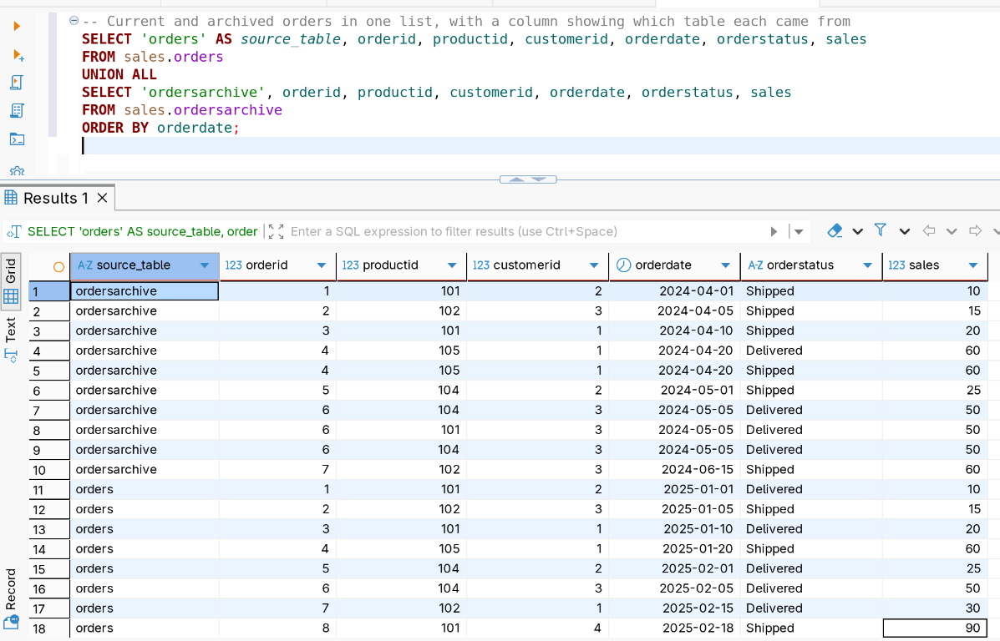
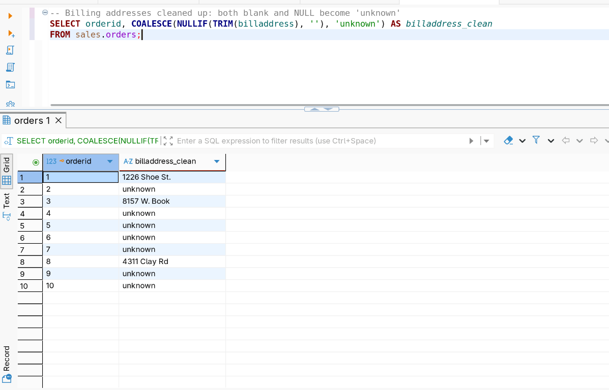
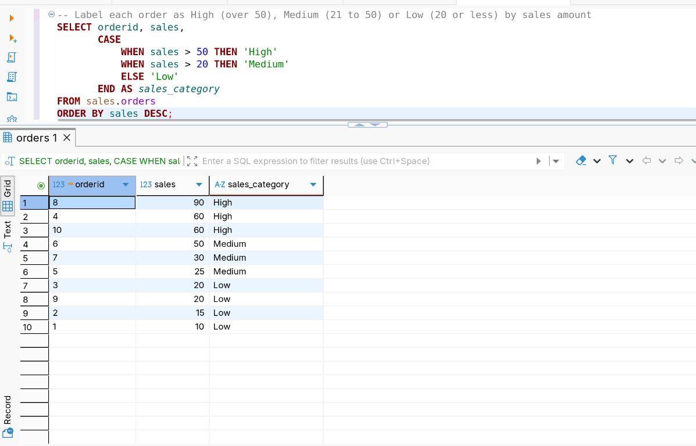
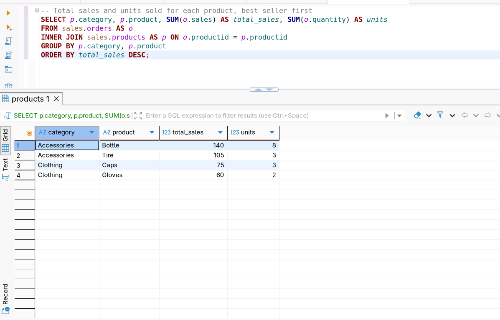
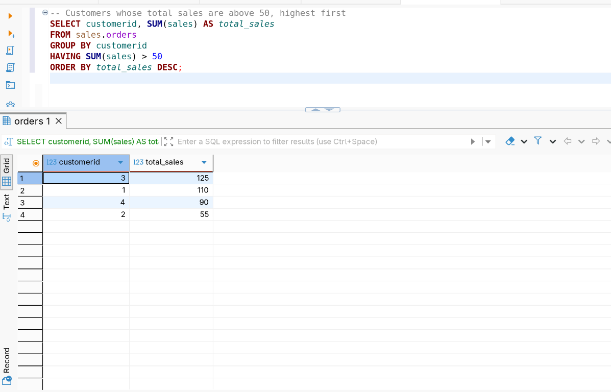

# Week 2: Joins, Functions and Aggregates

## Concepts covered

Filtering (`WHERE`, `IN`, `BETWEEN`, `LIKE`), joins (`INNER`, `LEFT`, `RIGHT`,
`FULL`, `CROSS`, anti and self joins), set operators (`UNION`, `UNION ALL`,
`EXCEPT`, `INTERSECT`), row-level functions (string, numeric, date and time,
`NULL`), `CASE`, and aggregate functions (`COUNT`, `SUM`, `AVG`, `MIN`, `MAX`,
`GROUP BY`, `HAVING`).

## Dataset

`salesdb` (schema `sales`), a richer dataset than week 1 so queries can span
several tables:

- `customers` (customerid, firstname, lastname, country, score)
- `employees` (employeeid, firstname, lastname, department, birthdate, gender, salary, managerid)
- `products` (productid, product, category, price)
- `orders` (orderid, productid, customerid, salespersonid, orderdate, shipdate, orderstatus, shipaddress, billaddress, quantity, sales, creationtime)
- `ordersarchive` (same columns as `orders`, with repeated `orderid`s)

Setup script: [`dataset/init-postgres-salesdb.sql`](./dataset/init-postgres-salesdb.sql)

Run the first two statements (drop and create `salesdb`) while connected to
`postgres`, then connect to `salesdb` and run the rest.

## Files

- [`queries/`](./queries) — one file per subtopic, simple → complex
  - [`01-filtering.sql`](./queries/01-filtering.sql)
  - [`02-joins-basic.sql`](./queries/02-joins-basic.sql)
  - [`03-joins-advanced.sql`](./queries/03-joins-advanced.sql)
  - [`04-set-operators.sql`](./queries/04-set-operators.sql)
  - [`05-string-functions.sql`](./queries/05-string-functions.sql)
  - [`06-numeric-functions.sql`](./queries/06-numeric-functions.sql)
  - [`07-date-time-functions.sql`](./queries/07-date-time-functions.sql)
  - [`08-null-functions.sql`](./queries/08-null-functions.sql)
  - [`09-case-statement.sql`](./queries/09-case-statement.sql)
  - [`10-aggregate-functions.sql`](./queries/10-aggregate-functions.sql)
- [`notes.md`](./notes.md) — what I learned, the SQL Server to PostgreSQL swaps, and what tripped me up
- `screenshots/postgres/` — result screenshots

## Highlights

**Setup:** `salesdb` loaded and connected in DBeaver, with the `sales` schema
and its five tables.



**Which customers have never placed an order?** (`LEFT JOIN` + `IS NULL` —
an anti join)

```sql
SELECT c.*
FROM sales.customers AS c
LEFT JOIN sales.orders AS o ON c.customerid = o.customerid
WHERE o.customerid IS NULL;
```



**Each order with the customer, product and salesperson names** (joining
four tables)

```sql
SELECT
    o.orderid,
    c.firstname AS customer,
    p.product,
    e.firstname AS salesperson,
    o.sales
FROM sales.orders AS o
LEFT JOIN sales.customers AS c ON o.customerid = c.customerid
LEFT JOIN sales.products AS p ON o.productid = p.productid
LEFT JOIN sales.employees AS e ON o.salespersonid = e.employeeid;
```



**Current and archived orders in one list, with a column showing which
table each came from** (`UNION ALL`)

```sql
SELECT 'orders' AS source_table, orderid, productid, customerid, orderdate, orderstatus, sales
FROM sales.orders
UNION ALL
SELECT 'ordersarchive', orderid, productid, customerid, orderdate, orderstatus, sales
FROM sales.ordersarchive
ORDER BY orderdate;
```



**Billing addresses cleaned up: both blank and `NULL` become 'unknown'**
(`COALESCE` + `NULLIF` + `TRIM`)

```sql
SELECT orderid, COALESCE(NULLIF(TRIM(billaddress), ''), 'unknown') AS billaddress_clean
FROM sales.orders;
```



**Label each order as High, Medium or Low by sales amount** (`CASE`)

```sql
SELECT orderid, sales,
       CASE
           WHEN sales > 50 THEN 'High'
           WHEN sales > 20 THEN 'Medium'
           ELSE 'Low'
       END AS sales_category
FROM sales.orders
ORDER BY sales DESC;
```



**Total sales and units sold for each product, best seller first** (join +
`GROUP BY` + `SUM`)

```sql
SELECT p.category, p.product, SUM(o.sales) AS total_sales, SUM(o.quantity) AS units
FROM sales.orders AS o
INNER JOIN sales.products AS p ON o.productid = p.productid
GROUP BY p.category, p.product
ORDER BY total_sales DESC;
```



**Which customers have total sales above 50?** (`HAVING` — filtering after
aggregation)

```sql
SELECT customerid, SUM(sales) AS total_sales
FROM sales.orders
GROUP BY customerid
HAVING SUM(sales) > 50
ORDER BY total_sales DESC;
```



## `ON` vs `WHERE` in a `LEFT JOIN`

A useful thing to internalize early: where a condition goes changes the
result.

- **In `ON`:** `LEFT JOIN sales.orders AS o ON c.customerid = o.customerid AND o.orderstatus = 'Delivered'`
  keeps every customer and only attaches their delivered orders.
- **In `WHERE`:** `... WHERE o.orderstatus = 'Delivered'` runs after the join
  and removes any customer without a delivered order. Mark (only a shipped
  order) and Anna (no orders) disappear, so the `LEFT JOIN` behaves like an
  `INNER JOIN`.

## Next up

Window functions: the basics, aggregate windows, ranking, and value functions such as `LAG` and `LEAD`.
