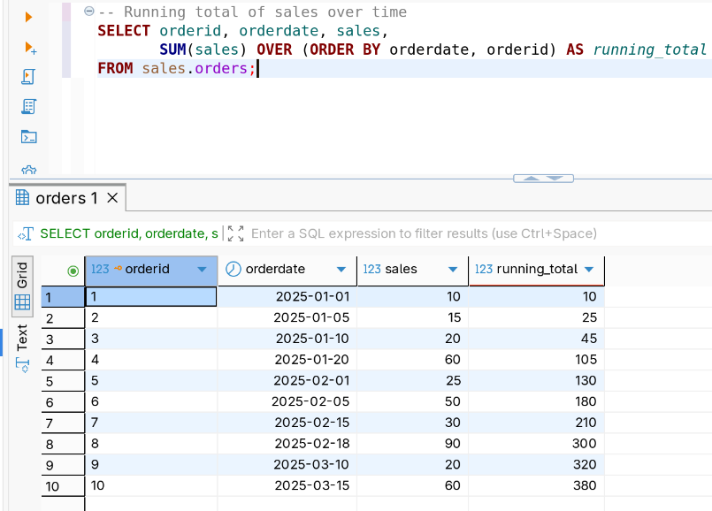
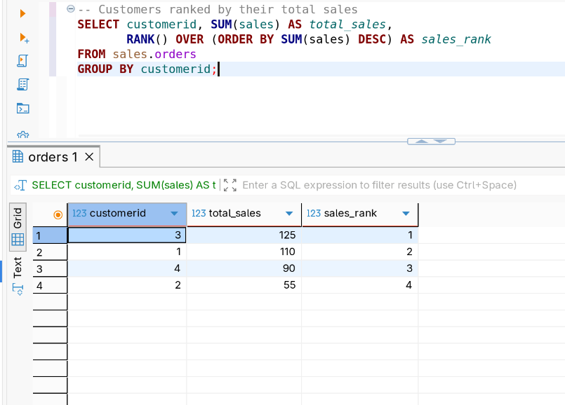
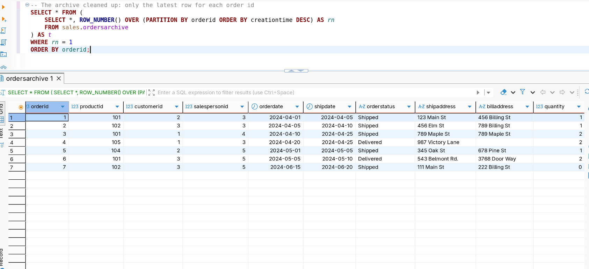
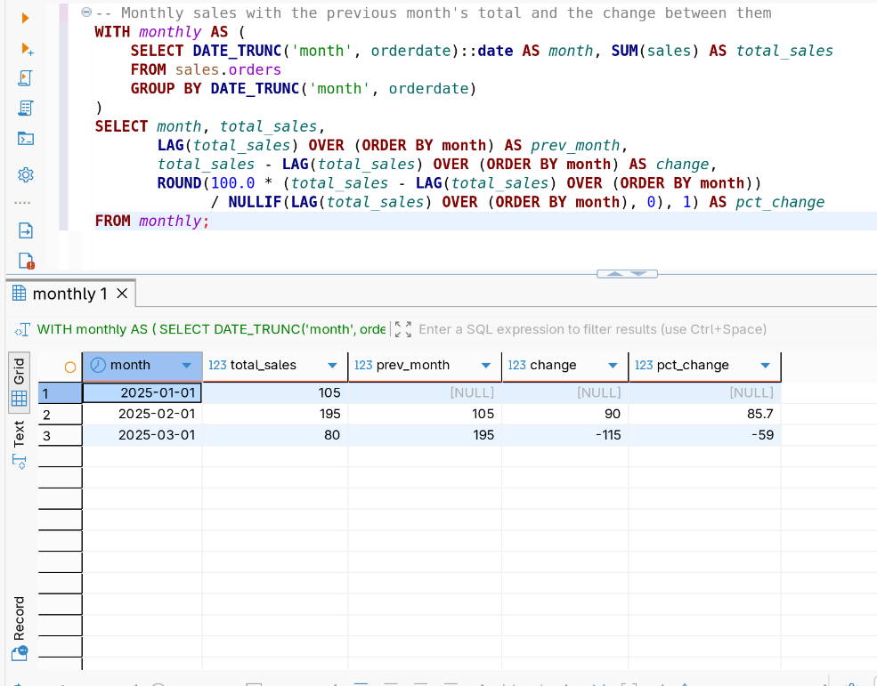
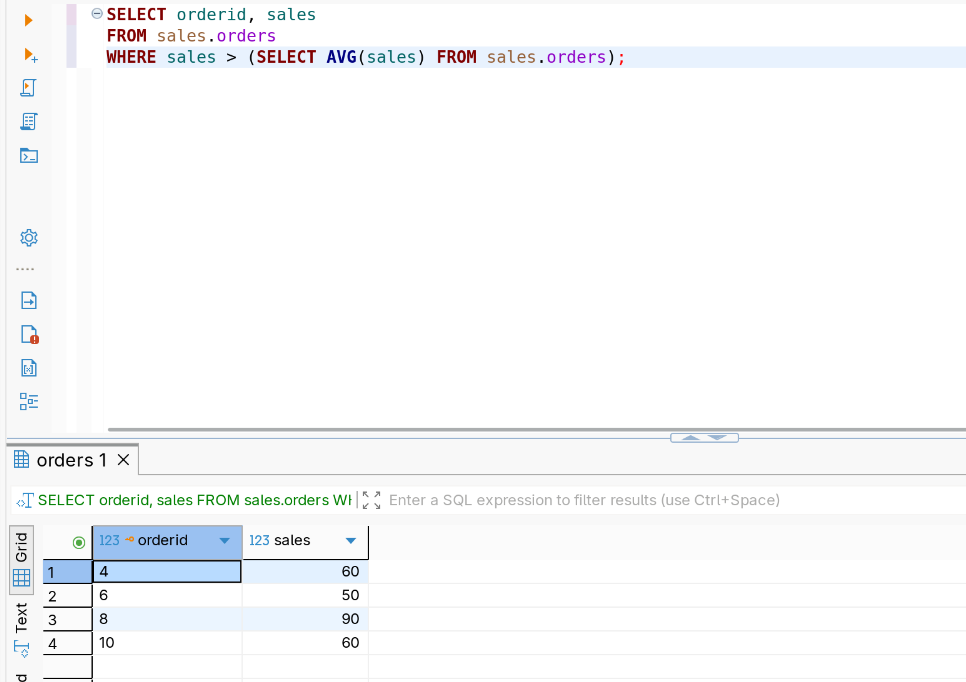
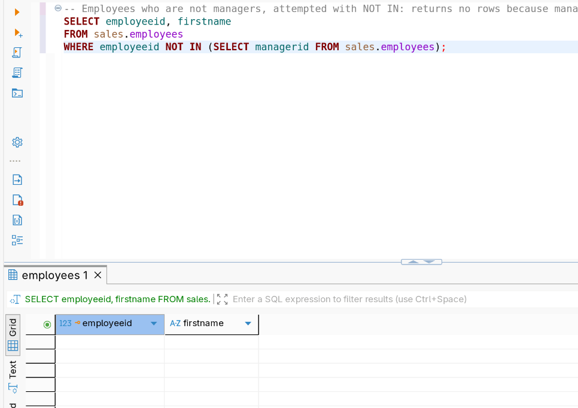
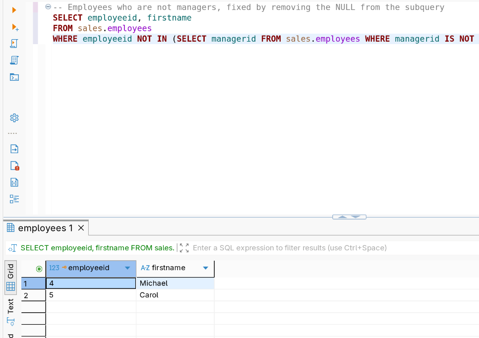
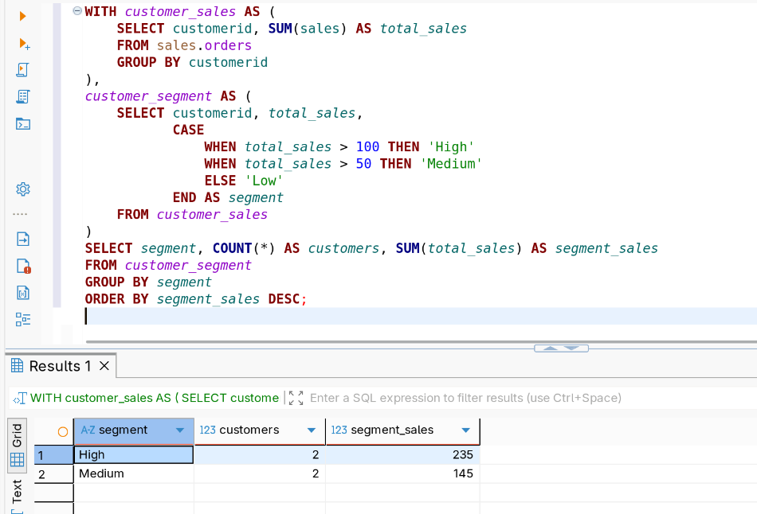
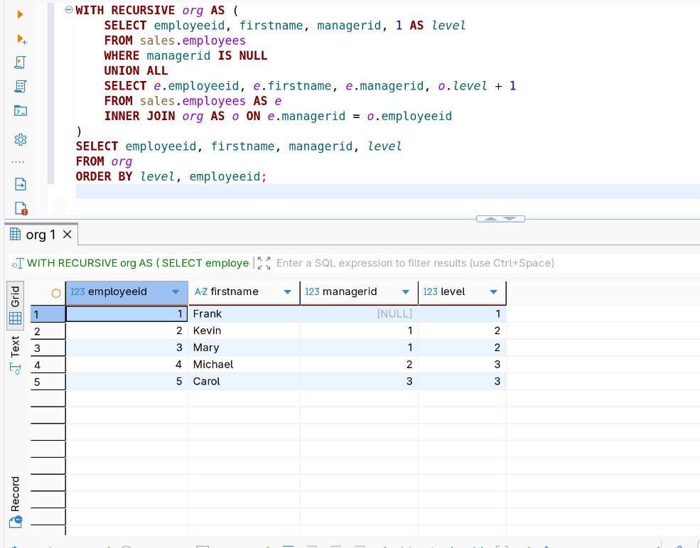

# Week 3: Window Functions, Subqueries and CTEs

## Concepts covered

Window functions (`OVER`, `PARTITION BY`, `ORDER BY`, frames), window
aggregates (`SUM`, `AVG`, `COUNT`, `MIN`, `MAX`), ranking (`ROW_NUMBER`,
`RANK`, `DENSE_RANK`, `NTILE`, `CUME_DIST`, `PERCENT_RANK`), value functions
(`LAG`, `LEAD`, `FIRST_VALUE`, `LAST_VALUE`), subqueries (in `FROM`, `SELECT`
and `WHERE`, correlated, `EXISTS`, `ANY`, `ALL`), and CTEs (standalone,
multiple, nested and recursive).

## Dataset

`salesdb` (schema `sales`), the same dataset as week 2, so the new techniques
are the only thing that changes:

- `customers` (customerid, firstname, lastname, country, score)
- `employees` (employeeid, firstname, lastname, department, birthdate, gender, salary, managerid)
- `products` (productid, product, category, price)
- `orders` (orderid, productid, customerid, salespersonid, orderdate, shipdate, orderstatus, shipaddress, billaddress, quantity, sales, creationtime)
- `ordersarchive` (same columns as `orders`, with repeated `orderid`s)

Setup script: [`dataset/init-postgres-salesdb.sql`](./dataset/init-postgres-salesdb.sql)

## Files

- [`queries/`](./queries) — one file per subtopic, simple → complex
  - [`01-window-aggregate.sql`](./queries/01-window-aggregate.sql)
  - [`02-window-ranking.sql`](./queries/02-window-ranking.sql)
  - [`03-window-value.sql`](./queries/03-window-value.sql)
  - [`04-subqueries.sql`](./queries/04-subqueries.sql)
  - [`05-cte-standalone.sql`](./queries/05-cte-standalone.sql)
  - [`06-cte-multiple-and-nested.sql`](./queries/06-cte-multiple-and-nested.sql)
  - [`07-cte-recursive.sql`](./queries/07-cte-recursive.sql)
- [`notes.md`](./notes.md) — what I learned, the SQL Server to PostgreSQL swaps, and what tripped me up
- `screenshots/postgres/` — result screenshots

## Highlights

**What is the running total of sales over time?** (`SUM` as a window
function with `ORDER BY`)

```sql
SELECT orderid, orderdate, sales,
       SUM(sales) OVER (ORDER BY orderdate, orderid) AS running_total
FROM sales.orders;
```



**How do customers rank by total sales?** (`RANK` over an aggregate)

```sql
SELECT customerid, SUM(sales) AS total_sales,
       RANK() OVER (ORDER BY SUM(sales) DESC) AS sales_rank
FROM sales.orders
GROUP BY customerid;
```



**The archive cleaned up: only the latest row for each order id**
(`ROW_NUMBER` + `PARTITION BY`, a common de-duplication pattern)

```sql
SELECT * FROM (
    SELECT *, ROW_NUMBER() OVER (PARTITION BY orderid ORDER BY creationtime DESC) AS rn
    FROM sales.ordersarchive
) AS t
WHERE rn = 1
ORDER BY orderid;
```



**How did sales change from month to month?** (`LAG` on monthly totals built
in a CTE)

```sql
WITH monthly AS (
    SELECT DATE_TRUNC('month', orderdate)::date AS month, SUM(sales) AS total_sales
    FROM sales.orders
    GROUP BY DATE_TRUNC('month', orderdate)
)
SELECT month, total_sales,
       LAG(total_sales) OVER (ORDER BY month) AS prev_month,
       total_sales - LAG(total_sales) OVER (ORDER BY month) AS change,
       ROUND(100.0 * (total_sales - LAG(total_sales) OVER (ORDER BY month))
             / NULLIF(LAG(total_sales) OVER (ORDER BY month), 0), 1) AS pct_change
FROM monthly;
```



**Which orders are above the average order value?** (subquery in `WHERE`)

```sql
SELECT orderid, sales
FROM sales.orders
WHERE sales > (SELECT AVG(sales) FROM sales.orders);
```



**Which employees are not managers?** The first attempt with `NOT IN`
returns nothing because the subquery contains a `NULL`.

```sql
SELECT employeeid, firstname
FROM sales.employees
WHERE employeeid NOT IN (SELECT managerid FROM sales.employees);
```



Removing the `NULL` from the subquery fixes it.

```sql
SELECT employeeid, firstname
FROM sales.employees
WHERE employeeid NOT IN (SELECT managerid FROM sales.employees WHERE managerid IS NOT NULL);
```



**How many customers fall in each sales segment?** (a nested CTE where the
second CTE builds on the first)

```sql
WITH customer_sales AS (
    SELECT customerid, SUM(sales) AS total_sales
    FROM sales.orders
    GROUP BY customerid
),
customer_segment AS (
    SELECT customerid, total_sales,
           CASE
               WHEN total_sales > 100 THEN 'High'
               WHEN total_sales > 50 THEN 'Medium'
               ELSE 'Low'
           END AS segment
    FROM customer_sales
)
SELECT segment, COUNT(*) AS customers, SUM(total_sales) AS segment_sales
FROM customer_segment
GROUP BY segment
ORDER BY segment_sales DESC;
```



**What does the organisation chart look like, level by level?** (a recursive
CTE walking the `managerid` column)

```sql
WITH RECURSIVE org AS (
    SELECT employeeid, firstname, managerid, 1 AS level
    FROM sales.employees
    WHERE managerid IS NULL
    UNION ALL
    SELECT e.employeeid, e.firstname, e.managerid, o.level + 1
    FROM sales.employees AS e
    INNER JOIN org AS o ON e.managerid = o.employeeid
)
SELECT employeeid, firstname, managerid, level
FROM org
ORDER BY level, employeeid;
```



## Why a window function can't go in `WHERE`

A useful thing to internalize early: window functions are calculated after
`WHERE`, `GROUP BY` and `HAVING` have run, so `WHERE` can't see their results.

- **Doesn't work:** `WHERE ROW_NUMBER() OVER (...) = 1`
- **Works:** calculate the number in a CTE or subquery, then filter in the
  outer query with `WHERE rn = 1`.

That is why the de-duplication and top-N queries are always wrapped.

## Next up

Views and CTAS (saving query results as database objects and tables).
