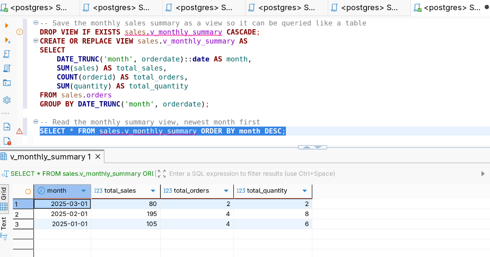
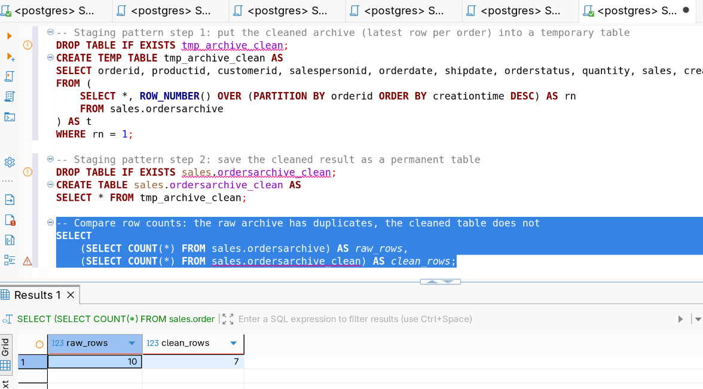
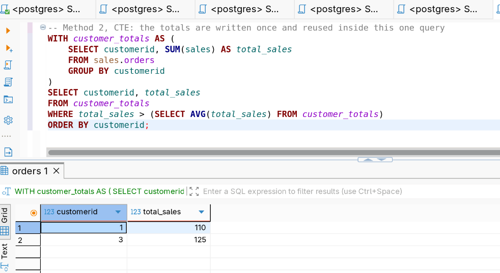
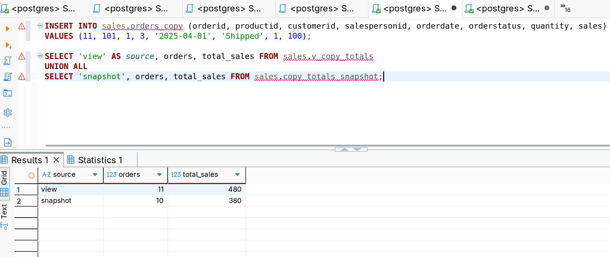
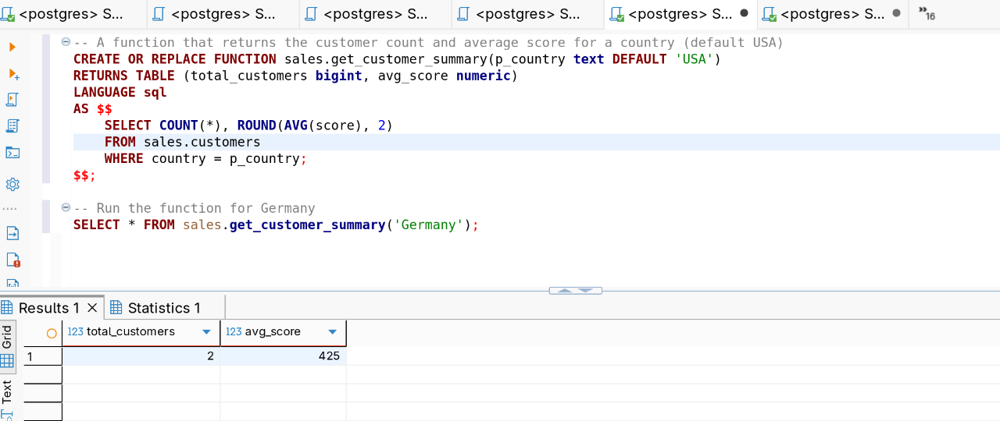
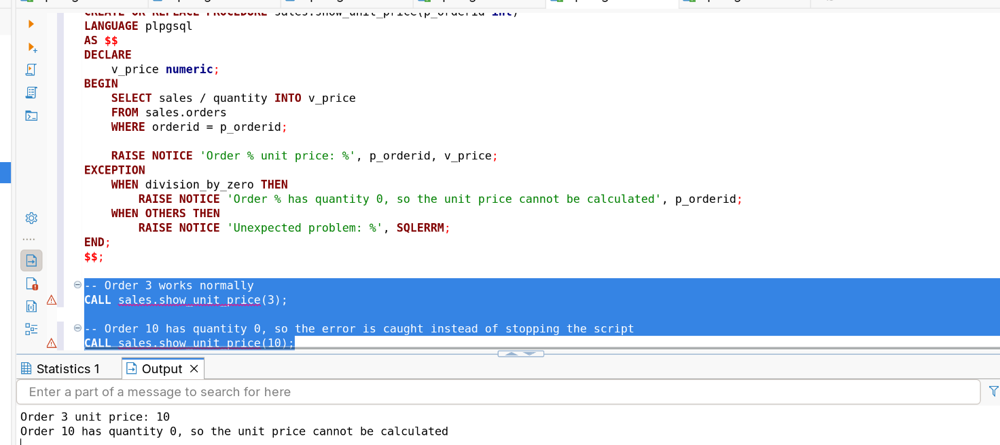
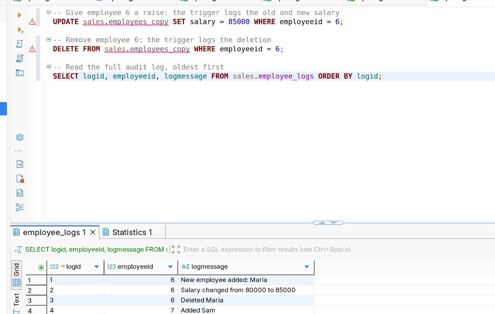
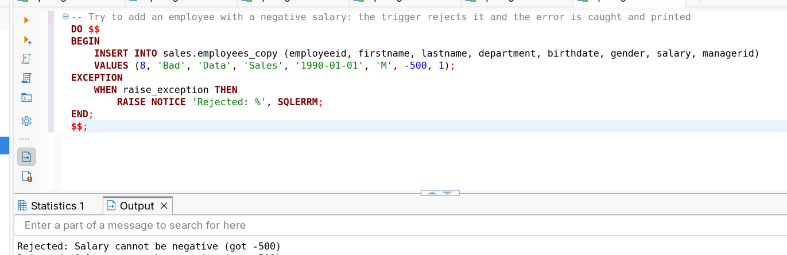

# Week 4: Views, CTAS, Temp Tables, Stored Procedures and Triggers

## Concepts covered

Views (including `CREATE OR REPLACE` and materialized views), CTAS
(`CREATE TABLE AS`), temporary tables, a comparison of subqueries, CTEs, views,
CTAS and temp tables on the same problem, stored procedures and functions
(parameters, variables, `IF`, error handling), and triggers (`AFTER`, `BEFORE`,
`NEW`, `OLD`, `TG_OP`).

## Dataset

`salesdb` (schema `sales`), the same dataset as weeks 2 and 3:

- `customers` (customerid, firstname, lastname, country, score)
- `employees` (employeeid, firstname, lastname, department, birthdate, gender, salary, managerid)
- `products` (productid, product, category, price)
- `orders` (orderid, productid, customerid, salespersonid, orderdate, shipdate, orderstatus, shipaddress, billaddress, quantity, sales, creationtime)
- `ordersarchive` (same columns as `orders`, with repeated `orderid`s)

Setup script: [`dataset/init-postgres-salesdb.sql`](./dataset/init-postgres-salesdb.sql)

This week creates objects and changes data, so the queries work on **copies**
of the tables (`orders_copy`, `customers_copy`, `employees_copy`). Run
[`06-cleanup.sql`](./queries/06-cleanup.sql) at the end to return `salesdb` to
the original five tables.

## Files

- [`queries/`](./queries) — one file per subtopic, run them in order
  - [`01-views.sql`](./queries/01-views.sql)
  - [`02-ctas-and-temp-tables.sql`](./queries/02-ctas-and-temp-tables.sql)
  - [`03-technique-comparison.sql`](./queries/03-technique-comparison.sql)
  - [`04-stored-procedures.sql`](./queries/04-stored-procedures.sql)
  - [`05-triggers.sql`](./queries/05-triggers.sql)
  - [`06-cleanup.sql`](./queries/06-cleanup.sql)
- [`notes.md`](./notes.md) — what I learned, the SQL Server to PostgreSQL swaps, and what tripped me up
- `screenshots/postgres/` — result screenshots

## Highlights

**How do I save a query so I don't rewrite it?** (a view over monthly totals)

```sql
CREATE OR REPLACE VIEW sales.v_monthly_summary AS
SELECT
    DATE_TRUNC('month', orderdate)::date AS month,
    SUM(sales) AS total_sales,
    COUNT(orderid) AS total_orders,
    SUM(quantity) AS total_quantity
FROM sales.orders
GROUP BY DATE_TRUNC('month', orderdate);

SELECT * FROM sales.v_monthly_summary ORDER BY month DESC;
```



**Which temp-table pattern cleans the archive?** (stage the latest row per
order in a temp table, then save the result permanently)

```sql
CREATE TEMP TABLE tmp_archive_clean AS
SELECT orderid, productid, customerid, salespersonid, orderdate, shipdate, orderstatus, quantity, sales, creationtime
FROM (
    SELECT *, ROW_NUMBER() OVER (PARTITION BY orderid ORDER BY creationtime DESC) AS rn
    FROM sales.ordersarchive
) AS t
WHERE rn = 1;

CREATE TABLE sales.ordersarchive_clean AS
SELECT * FROM tmp_archive_clean;

SELECT
    (SELECT COUNT(*) FROM sales.ordersarchive) AS raw_rows,
    (SELECT COUNT(*) FROM sales.ordersarchive_clean) AS clean_rows;
```



**Which customers are above the average customer total?** The same answer five
ways. Here is the CTE version:

```sql
WITH customer_totals AS (
    SELECT customerid, SUM(sales) AS total_sales
    FROM sales.orders
    GROUP BY customerid
)
SELECT customerid, total_sales
FROM customer_totals
WHERE total_sales > (SELECT AVG(total_sales) FROM customer_totals)
ORDER BY customerid;
```



**What happens when new data arrives?** A view stays live, a CTAS table is a
snapshot.

```sql
INSERT INTO sales.orders_copy (orderid, productid, customerid, salespersonid, orderdate, orderstatus, quantity, sales)
VALUES (11, 101, 1, 3, '2025-04-01', 'Shipped', 1, 100);

SELECT 'view' AS source, orders, total_sales FROM sales.v_copy_totals
UNION ALL
SELECT 'snapshot', orders, total_sales FROM sales.copy_totals_snapshot;
```



**How do I return a result from reusable logic?** A function returns rows,
because a PostgreSQL procedure can't.

```sql
CREATE OR REPLACE FUNCTION sales.get_customer_summary(p_country text DEFAULT 'USA')
RETURNS TABLE (total_customers bigint, avg_score numeric)
LANGUAGE sql
AS $$
    SELECT COUNT(*), ROUND(AVG(score), 2)
    FROM sales.customers
    WHERE country = p_country;
$$;

SELECT * FROM sales.get_customer_summary('Germany');
```



**How do I stop an error from ending the script?** Catching a divide by zero
inside a procedure.

```sql
CALL sales.show_unit_price(3);
CALL sales.show_unit_price(10);
```



**How do I log every change to a table automatically?** An audit trigger on
the employee copy.

```sql
UPDATE sales.employees_copy SET salary = 85000 WHERE employeeid = 6;
DELETE FROM sales.employees_copy WHERE employeeid = 6;

SELECT logid, employeeid, logmessage FROM sales.employee_logs ORDER BY logid;
```



**How do I block bad data before it is saved?** A `BEFORE` trigger rejecting a
negative salary.

```sql
DO $$
BEGIN
    INSERT INTO sales.employees_copy (employeeid, firstname, lastname, department, birthdate, gender, salary, managerid)
    VALUES (8, 'Bad', 'Data', 'Sales', '1990-01-01', 'M', -500, 1);
EXCEPTION
    WHEN raise_exception THEN
        RAISE NOTICE 'Rejected: %', SQLERRM;
END;
$$;
```



## Why a PostgreSQL procedure can't return a result set

In SQL Server a procedure can end with a `SELECT` and hand rows back. In
PostgreSQL a procedure only runs with `CALL` and returns nothing except `INOUT`
values, so anything that must return rows is written as a **function** and used
in `FROM`. Procedures are for actions: changing data, controlling transactions.
